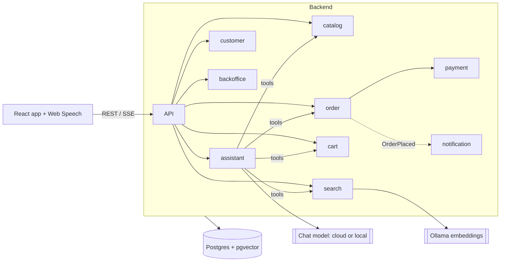
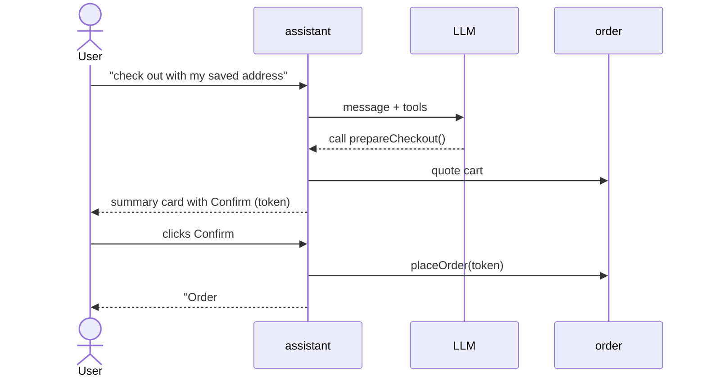

# Architecture

Shopwise is an online store where you can either click around like any other shop or just tell the assistant what you want, by typing or speaking. Both paths end up calling the same code, so the cart you build in the chat is the same cart you see on the page.

This document describes how it's put together.

## Constraints

- The assistant speaks English only (chat and voice).
- Code, docs and commits are in English.

## Stack

Java 21 and Spring Boot 4.1 on the backend, organized as a modular monolith with Spring Modulith. PostgreSQL 17 with the pgvector extension is the only database. Spring AI handles everything LLM-related, and Spring Batch is there for bulk jobs like catalog imports.

The frontend is React with Vite and TypeScript, with API types generated from the backend's OpenAPI spec. Voice uses the browser's built-in Web Speech API, so the backend never deals with audio.

## Modules

The backend is one Spring Boot app split into packages under `com.shopwise`. Spring Modulith checks in tests that modules only talk to each other through their public API or through events.

| Module | What it does |
|---|---|
| `catalog` | products, variants, prices, stock |
| `search` | hybrid text + vector search over the catalog |
| `cart` | anonymous and signed-in carts, coupons |
| `order` | checkout, order status, cancellation |
| `payment` | fake gateway for now, Stripe test mode later |
| `customer` | accounts, addresses, login |
| `assistant` | the chat agent, its tools, conversation memory |
| `notification` | order e-mails |
| `backoffice` | admin screens, CSV import, assistant stats |

Modules publish events like `OrderPlaced` or `ProductUpdated`. Modulith stores them in Postgres until they're handled, so we get reliable delivery without running a message broker.



## The assistant

The assistant is a Spring AI `ChatClient` with a set of tools. Each tool is a thin wrapper around a service the regular REST API also uses:

- `searchProducts`, `getProduct`
- `viewCart`, `addToCart`, `updateCartItem`, `applyCoupon`
- `prepareCheckout`, `confirmCheckout`
- `listOrders`, `trackOrder`
- `prepareCancel`, `confirmCancel`

A few rules keep it from doing damage:

**The model never decides who the user is.** No tool takes a customer id. Tools read the current user from Spring Security, same as a controller would.

**Prices and stock always come from the database.** If the model says something costs $10, that's just text. The order is priced by the `order` module.

**Anything you can't undo needs a confirmation.** Placing or cancelling an order is a two-step thing. `prepareCheckout` works out the total and saves a pending action with a random token that expires in 10 minutes. The UI shows a summary card with a Confirm button. Only `confirmCheckout(token)`, or the button itself, actually places the order. The token doubles as an idempotency key, so a double click can't create two orders, and if the cart changed in between, the token is rejected.

**Product text is data, not instructions.** Descriptions and reviews go into tool results clearly delimited, and the system prompt says to never follow instructions found there.

**No personal data goes to the model.** Tools return product names, prices and ids. Addresses show up as "your saved address on Main St" and get resolved on the server.

Anonymous users only get the read and cart tools. Every tool call that changes something is written to an audit log.



### Cloud or local model

You can run the chat on a free cloud API or entirely on your own machine, and switch between them.

- `cloud` uses the Gemini free tier, falling back to Groq when Gemini hits its quota. It's fast, but there are daily limits and the free-tier terms may let the provider use prompts for training.
- `local` uses Ollama with an open 8B-ish model that supports tool calling. Nothing leaves the server, but on a CPU-only VM it's slow, a few tokens per second.

The mode is set with `shopwise.ai.chat-mode=cloud|local` and can be changed from the backoffice while the app is running. A small routing `ChatModel` checks the current mode on every request. If `shopwise.ai.fallback-to-local` is on, the app also drops to local when both cloud providers are out of quota.

Embeddings always run locally on Ollama, whatever the chat mode. That way switching modes never means reindexing the catalog.

If no model is available at all, the chat says so and the rest of the store keeps working.

### Chat protocol

The frontend posts a message to `POST /api/assistant/conversations/{id}/messages` and gets a server-sent event stream back. Besides plain text tokens, the stream carries UI events the frontend renders as cards: `ui.products`, `ui.cart`, `ui.confirm`, `ui.order`. There's also `tool_status` (for "Adding to cart…") and `error`.

Conversation history is stored with Spring AI's JDBC chat memory. Long conversations get their older messages summarized to keep prompts small.

### Voice

The browser does the speech work. `SpeechRecognition` turns speech into text, which is sent to the same endpoint with `mode: "voice"`. In voice mode the assistant keeps answers to a sentence or two, skips markdown, and reads out at most three products. The reply is spoken with `speechSynthesis`, one sentence at a time. Talking over it stops playback.

Firefox doesn't support speech recognition, so the mic button is hidden there. In Chrome, recognition goes through Google's servers; that belongs in the privacy policy.

## Search

Search combines two rankings in one SQL query: pgvector similarity on product embeddings, and Postgres full-text search with the `english` config. The results are merged with reciprocal rank fusion, then filtered by price, category, attributes and stock in plain SQL.

When a product changes, a `ProductUpdated` listener re-embeds just that product. A full reindex is a Spring Batch job.

## Login and payment

Login is our own, built on Spring Security: e-mail and password with BCrypt, a server-side session in an HttpOnly cookie, CSRF protection, and password reset by e-mail. "Sign in with Google" goes through Spring's OAuth2 client and links to an existing account with the same verified e-mail. Two roles: `CUSTOMER` and `ADMIN`.

Payment is simulated until phase 4, behind a `PaymentGateway` interface. The fake gateway approves by default and declines everything when `shopwise.payment.simulated.decline-all` is set, so error paths get tested. Stripe test mode replaces it later without touching other modules.

Checkout works the same from the page and from the chat. A quote fingerprints the cart (items, quantities, prices, coupon); placing the order with a stale fingerprint fails, so the customer always pays the total they saw. Placing an order reserves stock, charges the payment and empties the cart in one transaction, and each checkout attempt carries an idempotency key. Standard shipping is $5 and free from $100 after discounts; express is $15. An order can be cancelled while it's paid but not shipped, which restocks the items and refunds the payment.

## Data

The main tables: `customer`, `address`, `password_reset_token`, `category`, `product`, `product_variant`, `inventory`, `search_document` (the search module's read model, with the embeddings), `cart`, `cart_item`, `coupon`, `orders`, `order_item`, `payment`, `assistant_conversation`, `pending_action`, `audit_log`, `assistant_llm_usage` (model calls and tokens per day and provider), `catalog_import_error`, and `app_setting` for runtime settings like the chat mode. Spring AI, Spring Session, Spring Batch and Modulith add their own tables to the same database.

Flyway manages migrations. Demo data lives in `db/seed`, numbered from V1000, and is only loaded outside production; out-of-order migrations are allowed so new schema changes still apply to databases that already have the seed.

A cart can belong to a customer or to an anonymous cookie id; it merges into the customer's cart on sign-in. Order items copy the product name and price at purchase time.

## Spring Batch

Batch is only for bulk work, never for the shopping flow.

- `catalogImportJob` reads a CSV uploaded in the backoffice, validates rows, upserts products and stock, and reports bad lines.
- `reindexEmbeddingsJob` rebuilds all embeddings, restartable if interrupted.
- `dailyReportJob` aggregates sales and assistant usage overnight.

Small recurring chores, like expiring pending actions, are plain `@Scheduled` methods.

## Running it

Locally, `deploy/docker-compose.yml` starts Postgres (pgvector image, on port 5433), Ollama with the embedding and chat models, and Mailpit for e-mails. The backend and frontend run from their folders. Cloud API keys and model names go in a git-ignored `.env` at the repo root, which the backend loads on startup. Without keys, the app runs in local mode. Prometheus and Grafana join the compose file with the production deploy.

In production, the same compose file runs on an Oracle Cloud Always Free ARM VM (4 cores, 24 GB) behind Caddy for HTTPS. The frontend is a static build on Cloudflare Pages. A nightly `pg_dump` goes to Oracle's free object storage. E-mail goes through the Brevo or Resend free tier. GitHub Actions builds the image, pushes it to GHCR and deploys over SSH. DuckDNS gives a free domain.

Rough memory use on the VM: Postgres 2 GB, backend 1 GB, Ollama with a quantized 8B model around 7 GB, monitoring 1 GB.

Things to keep in mind:

- Oracle may reclaim Always Free VMs that sit idle.
- Free-tier LLM limits and terms can change. Local mode is always there as a fallback.
- One VM means one point of failure. Backups live off the VM and the restore steps should be tested.

## Testing

Unit tests per module, `ApplicationModules.verify()` for module boundaries, and integration tests against a real Postgres with Testcontainers.

The assistant gets its own evals: scripted conversations like "find trail shoes, add size 10, check out" run against a test database. They check which tools were called and what ended up in the cart or order, not the exact wording. They run in local mode in CI and in cloud mode on demand, so both get measured.

## Requirements

Functional requirements, grouped by the phase they land in.

**Phase 1: catalog, cart and a working chat, all local**

- RF03 list and filter products by category, price and attributes
- RF04 product page with variants and stock
- RF05 text and semantic search
- RF06 add, remove and change cart items
- RF07 anonymous cart that merges on sign-in
- RF08 coupons
- RF15 do all of the above through the chat
- RF17 chat replies with product and cart cards
- RF21 the assistant says when it can't do something and points to the UI
- RF27 choose cloud or local chat model in config

**Phase 2: accounts, checkout, orders, voice**

- RF01 sign up and sign in with e-mail/password or Google, password reset
- RF02 profile and addresses
- RF09 shipping from a fixed rate table
- RF10 simulated payment
- RF11 order summary and explicit confirmation
- RF12 order history
- RF13 order status and tracking
- RF14 cancel an order before it ships
- RF16 voice input and output
- RF18 confirmation for irreversible actions in the chat
- RF20 resume past conversations
- RF26 order confirmation and status e-mails

**Phase 3: backoffice and production deploy**

- RF22 manage products, prices and stock
- RF23 CSV catalog import
- RF24 manage orders
- RF25 assistant stats: conversations, token use, conversion
- RF27 switch the chat model mode at runtime

**Phase 4**

- RF10 Stripe test mode instead of the fake gateway
- RF19 product comparison and recommendations

Non-functional: first chat token in under 2 seconds in cloud mode; the store works without the assistant; no duplicate orders; every agent action audited; conversations kept 90 days and deleted with the account; no personal data in logs or prompts; WCAG 2.1 AA; daily off-site backups.

## Layout

```
shopwise/
  backend/      Spring Boot app, one package per module
  frontend/     React + Vite
  deploy/       docker-compose files, Caddyfile
  README.md
  ARCHITECTURE.md
  CLAUDE.md
```
