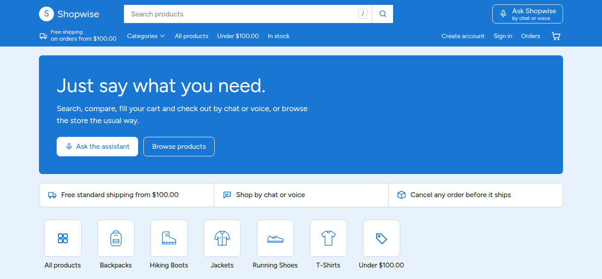
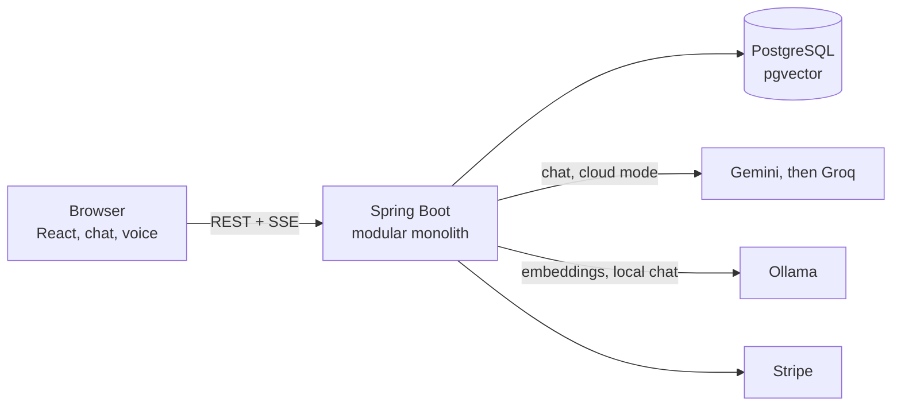

# Shopwise

An online store you can talk to. Shoppers search, compare, fill the cart, check out and track orders by chat or voice, or click through the store as usual. Both paths use the same services, so the chat and the page never disagree.



```
> I need running shoes under $100
> add the second one, size 10
> check out with my saved address
```

## Features

- **Assistant:** an LLM agent that calls tools for search, cart, checkout and orders. Prices and stock always come from the database, and orders need an explicit confirmation.
- **Voice:** speech in and out through the browser.
- **Search:** pgvector embeddings and PostgreSQL full-text search, merged with reciprocal rank fusion.
- **Recommendations:** similar products, and products bought together.
- **Store:** accounts, Google sign-in, coupons, orders, Stripe Checkout (simulated without keys).
- **Backoffice:** products, orders, CSV import, assistant conversations and usage.

## How it works



Modules, data flow and design decisions are in [ARCHITECTURE.md](ARCHITECTURE.md).

**Stack:** Java 21, Spring Boot 4.1, Spring Modulith, Spring AI, Spring Batch · PostgreSQL 17, pgvector · React 19, TypeScript, Vite · Docker, Caddy, GitHub Actions, Prometheus, Grafana

## Run it

You need Java 21, Node 22 and Docker.

```bash
cp .env.example .env
docker compose -f deploy/docker-compose.yml up -d
cd backend && ./mvnw spring-boot:run
```

In another terminal:

```bash
cd frontend
nvm use
npm install
npm run dev
```

Open http://localhost:5173. The first start downloads the Ollama models (about 5 GB).

## AI setup

| Mode | Models | Needs |
|---|---|---|
| `cloud` | Gemini, falling back to Groq | `GEMINI_API_KEY` and/or `GROQ_API_KEY` |
| `local` | Ollama, `qwen2.5:7b` | a machine that can run it; slow without a GPU |

Get a key from [Google AI Studio](https://aistudio.google.com/apikey) or [Groq](https://console.groq.com/keys), then set it in `.env` and restart the backend:

```
SHOPWISE_AI_CHAT_MODE=cloud
GEMINI_API_KEY=...
GROQ_API_KEY=...
```

Admins (`SHOPWISE_ADMIN_EMAILS`) can switch modes in the backoffice. A mode chosen there is saved and takes precedence over `.env`. Embeddings always run on Ollama.

## Tests

```bash
cd backend && ./mvnw verify           # unit, module and integration tests (Testcontainers)
cd backend && ./mvnw verify -Pevals   # assistant conversations against local Ollama
cd frontend && npm run check          # lint, types and component tests
```

## Deploy

One VM with Docker Compose, with HTTPS from Caddy and images built by GitHub Actions. Steps are in [deploy/README.md](deploy/README.md).
